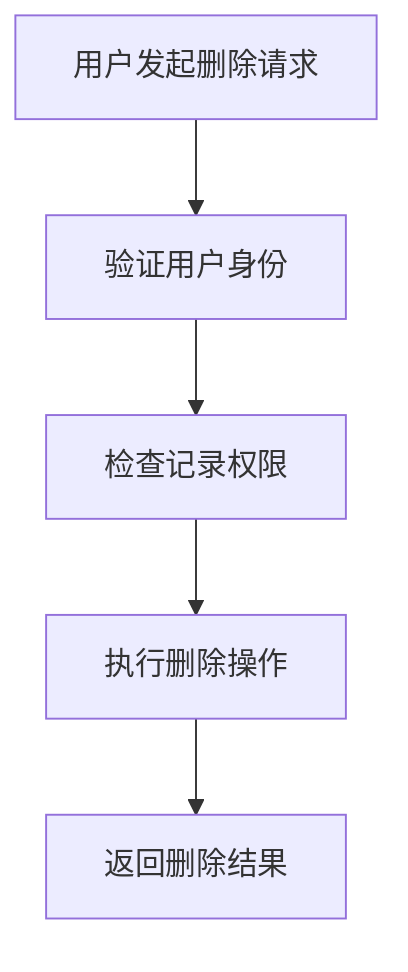

# 删除看展记录图片功能需求文档

## 1. Product Overview
删除看展记录中指定图片的功能，允许用户管理自己的展览记录中的图片资源。
- 用户可以删除自己看展记录中不需要的图片，保持记录的整洁性
- 确保数据一致性和用户权限验证，防止误删或恶意删除

## 2. Core Features

### 2.1 User Roles
| Role | Registration Method | Core Permissions |
|------|---------------------|------------------|
| 认证用户 | 已登录用户 | 可以删除自己看展记录中的图片 |

### 2.2 Feature Module
我们的删除图片功能包含以下核心模块：
1. **图片删除接口**：处理删除请求，验证权限，执行删除操作

### 2.3 Page Details
| Page Name | Module Name | Feature description |
|-----------|-------------|---------------------|
| 图片删除接口 | 权限验证模块 | 验证用户是否有权限删除指定记录的图片 |
| 图片删除接口 | 数据一致性模块 | 确保图片删除后相关数据的一致性 |
| 图片删除接口 | 删除执行模块 | 执行实际的图片删除操作 |

## 3. Core Process
用户删除图片的主要操作流程：
1. 用户发送删除图片请求，包含展览记录ID和图片ID
2. 系统验证用户身份和权限
3. 系统检查展览记录是否属于当前用户
4. 系统执行图片删除操作
5. 系统返回删除结果

## 4. User Interface Design
### 4.1 Design Style
- 主色调：系统默认色彩方案
- 按钮样式：简洁的删除按钮
- 字体：系统默认字体
- 布局风格：RESTful API接口，无UI界面
- 图标建议：删除相关的图标样式

### 4.2 Page Design Overview
| Page Name | Module Name | UI Elements |
|-----------|-------------|-------------|
| API接口 | 删除接口 | RESTful DELETE请求，JSON格式响应 |

### 4.3 Responsiveness
该功能为后端API接口，不涉及前端响应式设计。