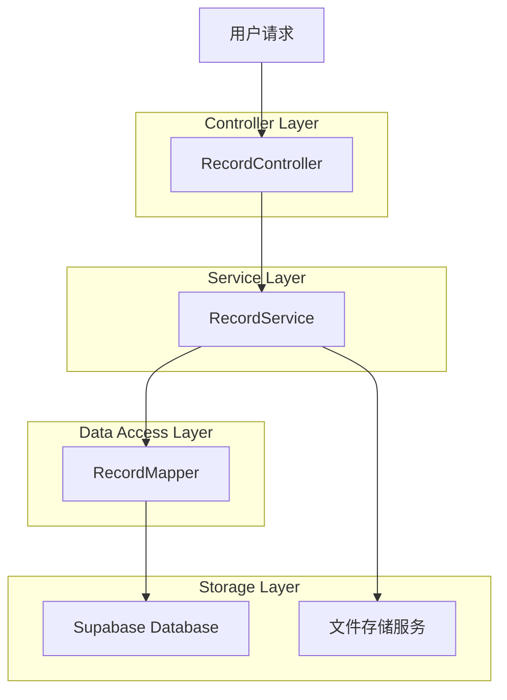
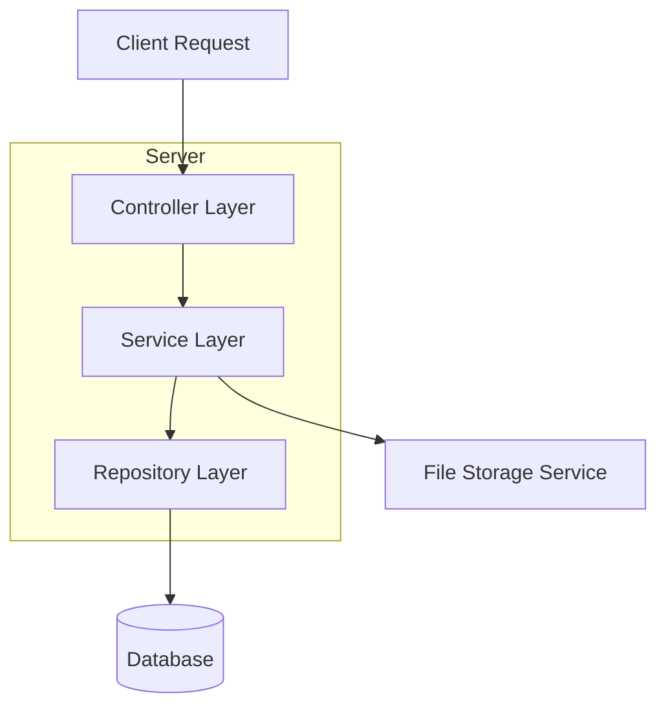
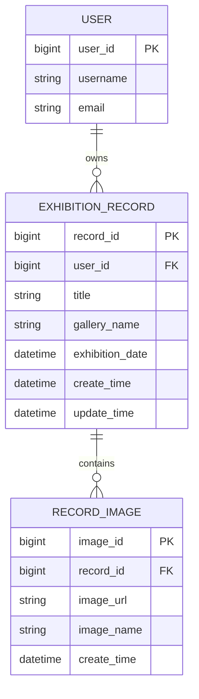

# 删除看展记录图片技术架构文档

## 1. Architecture design



## 2. Technology Description

* Frontend: 无（纯后端API）

* Backend: Spring Boot + MyBatis

* Database: Supabase (PostgreSQL)

* File Storage: 文件存储服务

## 3. Route definitions

| Route                            | Purpose      |
| -------------------------------- | ------------ |
| DELETE /user/record/image/delete | 删除看展记录中的指定图片 |

## 4. API definitions

### 4.1 Core API

删除看展记录图片

```
DELETE /user/record/image/delete
```

Request:

| Param Name | Param Type | isRequired | Description |
| ---------- | ---------- | ---------- | ----------- |
| recordId   | string     | true       | 展览记录ID      |
| imageId    | string     | true       | 图片ID        |

Response:

| Param Name | Param Type | Description |
| ---------- | ---------- | ----------- |
| code       | integer    | 响应状态码       |
| msg        | string     | 响应消息        |
| data       | object     | 响应数据（空对象）   |

Example Request:

```json
{
  "recordId": "1001",
  "imageId": "1001"
}
```

Example Response:

```json
{
  "code": 1,
  "msg": null,
  "data": {}
}
```

## 5. Server architecture diagram



## 6. Data model

### 6.1 Data model definition



### 6.2 Data Definition Language

图片表 (record\_images)

```sql
-- 创建图片表
CREATE TABLE record_images (
    image_id BIGSERIAL PRIMARY KEY,
    record_id BIGINT NOT NULL,
    image_url VARCHAR(500) NOT NULL,
    image_name VARCHAR(255),
    create_time TIMESTAMP WITH TIME ZONE DEFAULT NOW(),
    CONSTRAINT fk_record_images_record_id FOREIGN KEY (record_id) REFERENCES exhibition_records(record_id) ON DELETE CASCADE
);

-- 创建索引
CREATE INDEX idx_record_images_record_id ON record_images(record_id);
CREATE INDEX idx_record_images_create_time ON record_images(create_time DESC);

-- 权限设置
GRANT SELECT ON record_images TO anon;
GRANT ALL PRIVILEGES ON record_images TO authenticated;
```

删除图片的核心SQL：

```sql
-- 删除指定记录的指定图片（需要验证用户权限）
DELETE FROM record_images 
WHERE image_id = #{imageId} 
  AND record_id IN (
    SELECT record_id 
    FROM exhibition_records 
    WHERE record_id = #{recordId} 
      AND user_id = #{userId}
  );
```

