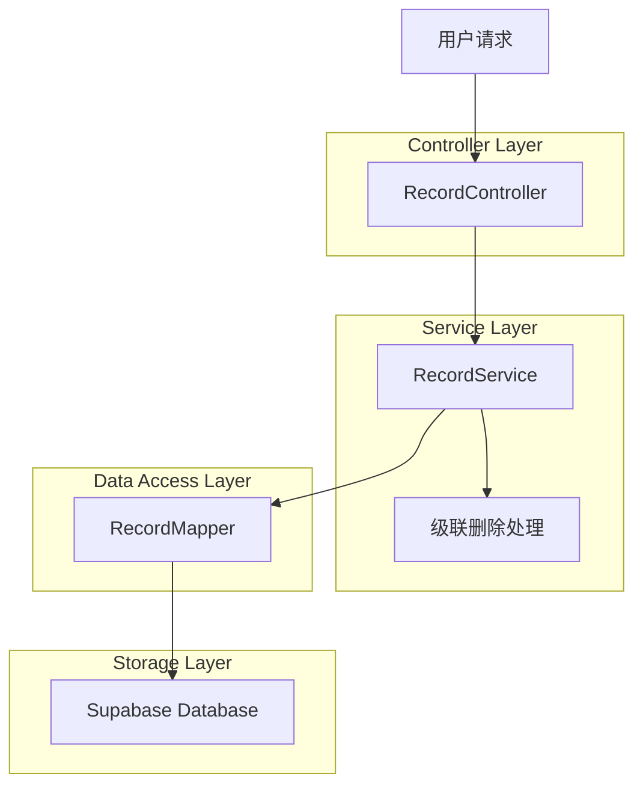
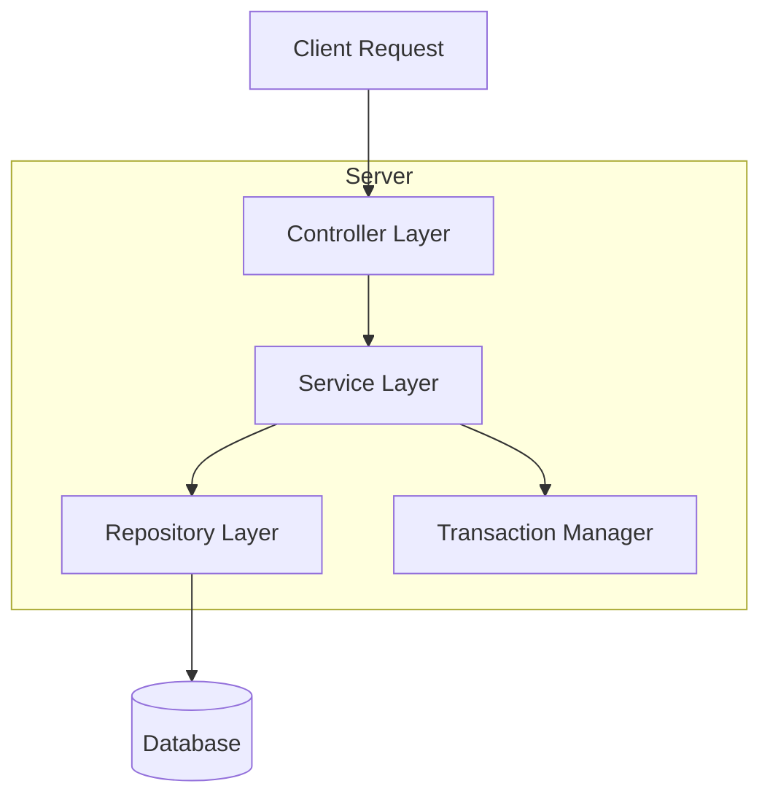
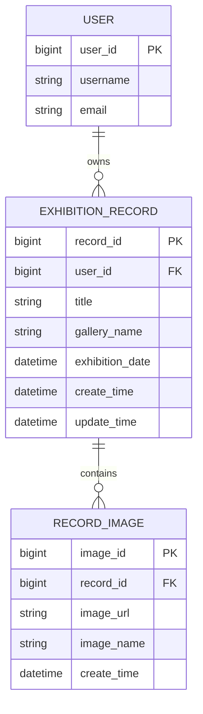

# 删除看展记录技术架构文档

## 1. Architecture design



## 2. Technology Description

- Frontend: 无（纯后端API）
- Backend: Spring Boot + MyBatis
- Database: Supabase (PostgreSQL)
- Transaction Management: Spring事务管理

## 3. Route definitions

| Route | Purpose |
|-------|----------|
| DELETE /user/record/delete | 删除整个看展记录及其相关数据 |

## 4. API definitions

### 4.1 Core API

删除看展记录

```
DELETE /user/record/delete
```

Request:

| Param Name | Param Type | isRequired | Description |
|------------|------------|------------|-------------|
| recordId   | string     | true       | 展览记录ID |

Response:

| Param Name | Param Type | Description |
|------------|------------|-------------|
| code       | integer    | 响应状态码 |
| msg        | string     | 响应消息 |
| data       | object     | 响应数据（空对象） |

Example Request:

```json
{
  "recordId": "1001"
}
```

Example Response:

```json
{
  "code": 1,
  "msg": null,
  "data": {}
}
```

## 5. Server architecture diagram



## 6. Data model

### 6.1 Data model definition



### 6.2 Data Definition Language

展览记录表 (exhibition_record)

```sql
-- 展览记录表已存在，支持级联删除
CREATE TABLE exhibition_record (
    record_id BIGSERIAL PRIMARY KEY,
    user_id BIG